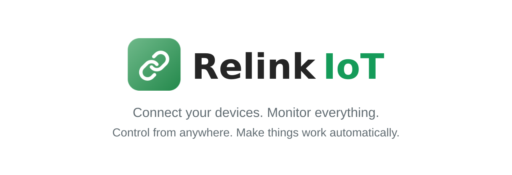

<p align="center">
  
</p>

<h1 align="center">Relink IoT Libraries</h1>

<p align="center">
  <b>Connect anything.</b> ESP32, ESP8266, Raspberry Pi, servers, and Python scripts —
  one set of virtual pins, one live dashboard.
</p>

<p align="center">
  <a href="https://relink-iot.com">Website</a> ·
  <a href="#quick-start">Quick start</a> ·
  <a href="#examples">Examples</a> ·
  <a href="#api-at-a-glance">API</a> ·
  <a href="#troubleshooting">Troubleshooting</a>
</p>

---

## What is Relink IoT?

Relink IoT links your hardware and software to a real-time web dashboard at
**[relink-iot.com](https://relink-iot.com)**. Every program that uses the same device
token shares **virtual pins** (`V0`, `V1`, …). A write from any of them reaches the
others and the dashboard.

```
  ESP32 sensor ──┐                       ┌── Web dashboard (phone / PC)
                 ├──  relink-iot.com  ───┤
  Python script ─┤   (or direct P2P)     └── C++ service on a Raspberry Pi
```

- **Encrypted** end to end with your device key (ChaCha20-Poly1305).
- **Direct P2P** between devices when the network allows it, with automatic relay fallback.
- **OTA firmware updates** from the dashboard.
- **Live camera streaming** on supported ESP32 camera boards.
- **Same API in three languages:** Arduino, C++, and Python.

## Download

| Library | Folder | Runs on | File |
|---|---|---|---|
| **Arduino** | [`arduino/`](arduino) | ESP32, ESP32-S2/S3/C3/C5/C6/P4, ESP8266 | `arduino/RelinkIoT-1.0.3.zip` |
| **C++** | [`cpp/`](cpp) | Linux x86_64 (OpenSSL + zlib) | `cpp/relink-1.0.3-linux-x86_64.tar.gz` |
| **Python** | [`python/`](python) | Linux x86_64, Python 3.12 | `python/relink_iot-1.0.3-cp312-cp312-linux_x86_64.whl` |

> The libraries are precompiled. The C++ and Python builds are currently for
> **Linux x86_64 only**, and the Python wheel for **Python 3.12 only**. Raspberry Pi
> (arm64) and macOS builds are coming.
> **ESP8266:** builds and runs the examples, but hasn't been tested on a real board yet.
> ESP32 is tested on hardware.

## Quick start

**1. Create a device** on [relink-iot.com](https://relink-iot.com). Open it, then go to
*Datastreams* and add **V0** (Float) and **V1** (Integer).
Add a **Label** widget on V0 and a **Toggle** widget on V1.

**2. Copy the token and key** from the device page.

**3. Pick your platform.** Each one sends a number to V0 and prints whatever the
dashboard writes to V1.

<details open><summary><b>Arduino (ESP32 / ESP8266)</b></summary>

1. Download `arduino/RelinkIoT-1.0.3.zip`.
2. In the Arduino IDE: *Sketch → Include Library → Add .ZIP Library…* and pick the zip.
3. Open *File → Examples → RelinkIoT → BasicSensor*.
4. Fill in your Wi-Fi, token, and key, then upload.

**PlatformIO** (`platformio.ini`):

```ini
lib_deps = https://github.com/NonStopBle/Relink-IoT/raw/main/arduino/RelinkIoT-1.0.3.zip
```

No other libraries are needed: the crypto code is already linked in.
</details>

<details><summary><b>Python</b></summary>

```bash
git clone https://github.com/NonStopBle/Relink-IoT.git && cd Relink-IoT
pip install python/relink_iot-*.whl                 # pulls in `cryptography`

export RELINK_TOKEN=your-token RELINK_KEY=your-key RELINK_SERVER=relink-iot.com
python3 python/examples/basic.py
```
</details>

<details><summary><b>C++ (Linux)</b></summary>

```bash
sudo apt install build-essential cmake libssl-dev zlib1g-dev
git clone https://github.com/NonStopBle/Relink-IoT.git && cd Relink-IoT

cmake -S cpp/relink/examples -B build && cmake --build build
export RELINK_TOKEN=your-token RELINK_KEY=your-key RELINK_SERVER=relink-iot.com
./build/relink_basic
```

To use it in your own CMake project:

```cmake
set(relink_DIR /path/to/Relink-IoT/cpp/relink/lib/cmake/relink)
find_package(relink REQUIRED)
target_link_libraries(my_app relink::relink)   # -DRELINK_STATIC=ON links librelink.a
```
</details>

**4. Check it works:** the Label shows the value. Flip the Toggle and the new V1 value
appears in the terminal or Serial Monitor.

> Keep the server as **`relink-iot.com`**. Only change it if you run your own Relink server.

## Examples

All three libraries ship the same examples, so you can mix and match. For example, an
ESP32 running `ByteArray` can talk to `bytes.py` on a PC.

| I want to… | Arduino | C++ | Python | Datastreams to add |
|---|---|---|---|---|
| Send a value and react to a button | `BasicSensor` | `basic.cpp` | `basic.py` | V0 Float, V1 Integer |
| See everything other programs write | `Listen` | `listen.cpp` | `listen.py` | any |
| Send packed sensor records or raw bytes | `ByteArray` | `bytes.cpp` | `bytes.py` | V2, V3 ByteArray |
| Stream a live camera (P2P) | `CameraStream` (sends) | `camera.cpp` (receives) | `camera.py` (receives) | V10 Camera, V11 ByteArray |
| Show the camera in an OpenGL window | `CameraStream` | `camera_gl.cpp` (freeglut + libjpeg) | `camera_gl.py` (`pip install glfw PyOpenGL`) | V10 Camera, V11 ByteArray |
| Handle Wi-Fi myself | `WiFiEvents` | — | — | V0 |
| Let Relink handle Wi-Fi | `RelinkConfig` | — | — | V0, V1 |

Every example is laid out the same way. A header says which datastreams to add and
what you'll see, then the code runs **1. settings → 2. connect → 3. handlers → 4. loop**.

- **Arduino:** settings are `#define`s at the top of each sketch.
- **C++:** settings are in `cpp/relink/examples/settings.hpp`.
- **Python:** settings are at the top of each file.
- In C++ and Python, the `RELINK_TOKEN`, `RELINK_KEY`, and `RELINK_SERVER` environment
  variables override them.

**Value types:** int, float, text, and ByteArray (raw bytes: up to 58 from an ESP32,
255 from C++/Python). They match the datastream types on the dashboard.

## API at a glance

<details open><summary><b>Arduino</b></summary>

```cpp
#include <WiFi.h>
#include <RelinkIoT.h>

#define WIFI_SSID       "YourWiFiName"
#define WIFI_PASS       "YourWiFiPassword"
#define DEVICE_TOKEN    "your-device-token"
#define DEVICE_ENC_KEY  "your-64-hex-character-key"
#define RELINK_SERVER   "relink-iot.com"
#define LED_PIN         2

RELINK_WRITE(V1) {                       // called when V1 changes
  analogWrite(LED_PIN, constrain(param.asInt(), 0, 255));
}

void setup() {
  Serial.begin(115200);
  pinMode(LED_PIN, OUTPUT);
  Relink.config(WIFI_SSID, WIFI_PASS);   // let Relink connect / reconnect Wi-Fi
  Relink.begin(DEVICE_TOKEN, DEVICE_ENC_KEY, RELINK_SERVER);
}

void loop() {
  Relink.run();                          // keep this running: no long delay()
  static unsigned long last = 0;
  if (millis() - last >= 1000) {
    last = millis();
    Relink.virtualWrite(V0, analogRead(A0));
  }
}
```

- Raw bytes: `uint8_t rec[] = {10, 20, 30, 1}; Relink.virtualWrite(V2, rec, sizeof(rec));`
- Your own Wi-Fi (static IP, WiFiManager…): skip `Relink.config()`, see `WiFiEvents`.
- Camera: `CameraStream`. Set your board's pins in `camera_pins.h`.
</details>

<details><summary><b>Python</b></summary>

```python
from relink_iot import Relink

r = Relink(TOKEN, ENC_KEY, "relink-iot.com")

@r.on_pin(1)
def led(v):
    print("V1 =", v)

r.start()                  # background thread, or call r.run() from your own loop
r.virtual_write(0, 21.5)   # writes made between ticks are batched into one packet
print(r.peers())           # {instance: 'p2p' | 'relay'}
```
</details>

<details><summary><b>C++</b></summary>

```cpp
#include <relink/relink.hpp>

relink::Client r(TOKEN, ENC_KEY, "relink-iot.com");
r.onPin(1, [](const relink::Value& v) { printf("V1 = %d\n", v.asInt()); });
r.start();
r.virtualWrite(0, 21.5f);
```
</details>

## Troubleshooting

| Problem | Check |
|---|---|
| Device never shows online | Token and key copied exactly (the key is 64 hex characters); `RELINK_SERVER` is `relink-iot.com`; the network allows outgoing UDP |
| Dashboard writes don't arrive | `Relink.run()` is called continuously, with no long `delay()` in `loop()`; the datastream exists for that pin |
| Values show the wrong type | The datastream type (Integer / Float / String / ByteArray) matches what you write |
| `pip` says the wheel is "not supported" | The wheel is for Python 3.12 on Linux x86_64; check `python3 --version` and `uname -m` |
| C++: `find_package(relink)` fails | `relink_DIR` points at `cpp/relink/lib/cmake/relink`, and `libssl-dev` and `zlib1g-dev` are installed |
| Camera shows nothing | `CameraStream` is on a supported ESP32 camera board, with V10 Camera and V11 ByteArray added |

## Security

Never commit real tokens or keys to Git. An empty key (`""`) disables encryption and
is only for local testing.

---

<p align="center">
  Created by <b>Rezier Labs</b> · <a href="https://relink-iot.com">relink-iot.com</a>
</p>
